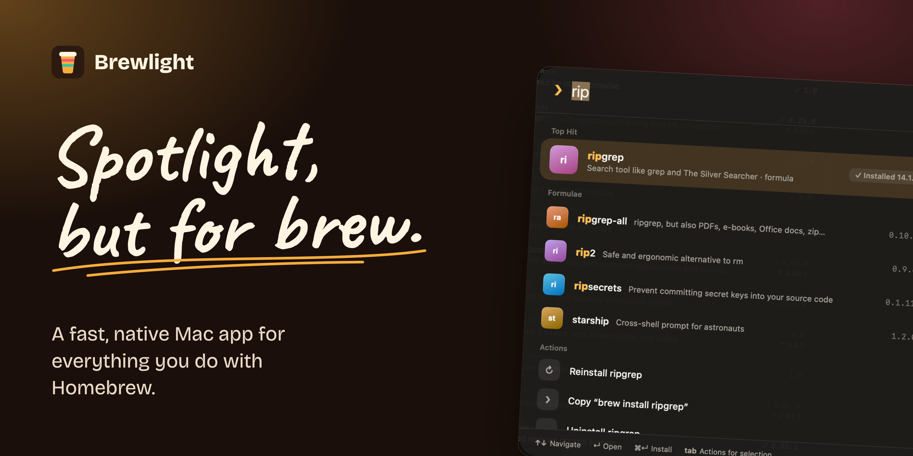
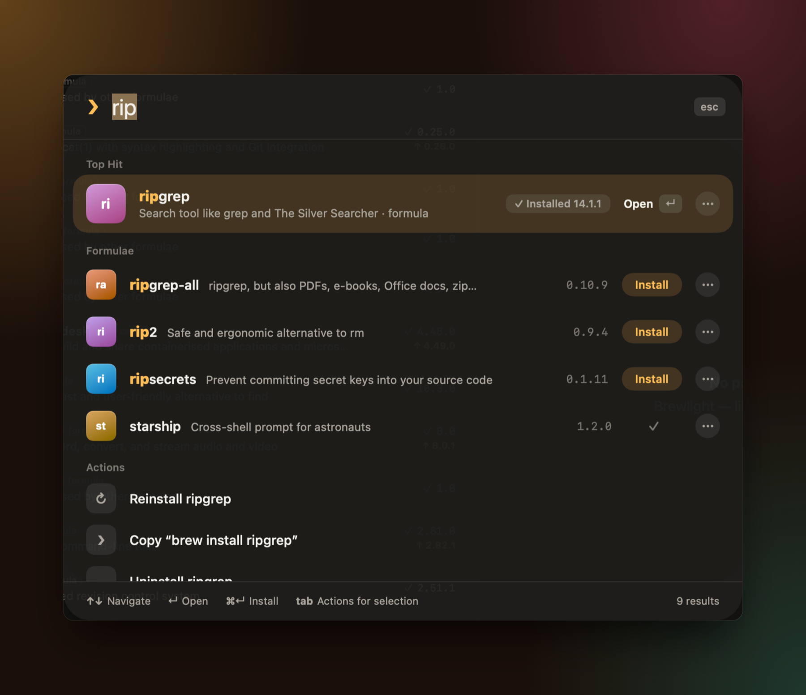
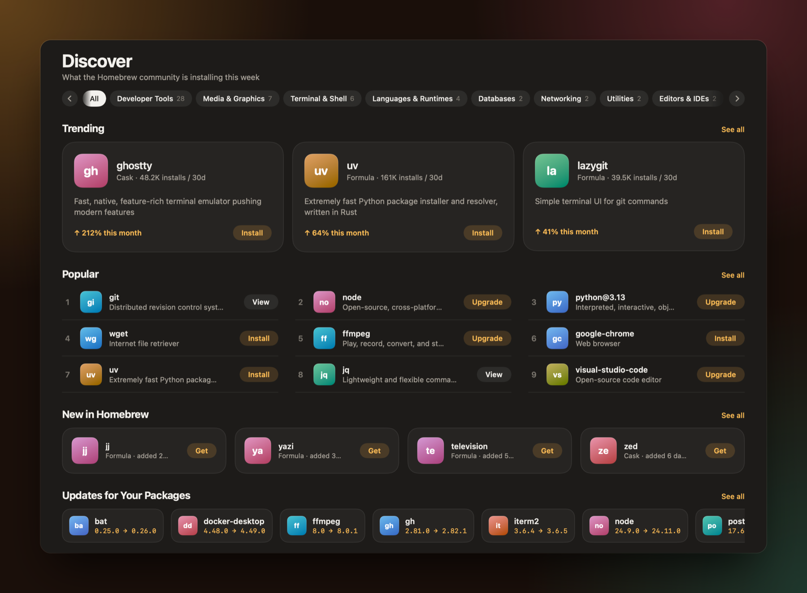
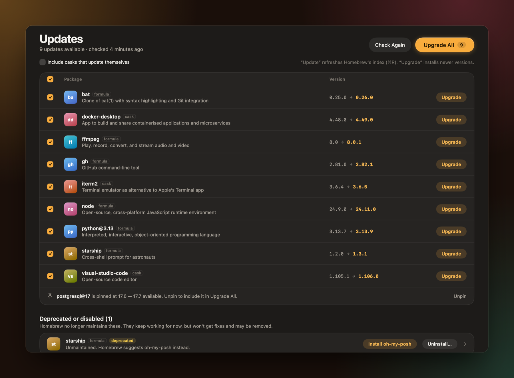
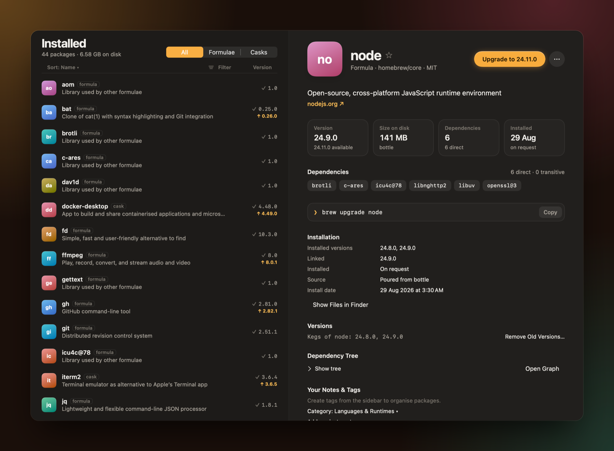

<p align="center">
  
</p>

<p align="center">
  <a href="https://prempoddar.github.io/Brewlight/"></a>
  
  
  
  <a href="LICENSE"></a>
  <a href="https://github.com/PremPoddar/Brewlight/stargazers"></a>
</p>

<p align="center">
  <a href="https://prempoddar.github.io/Brewlight/"><b>Website</b></a>
  &nbsp;&nbsp;|&nbsp;&nbsp;
  <a href="#install"><b>Install</b></a>
  &nbsp;&nbsp;|&nbsp;&nbsp;
  <a href="#what-it-does"><b>Features</b></a>
  &nbsp;&nbsp;|&nbsp;&nbsp;
  <a href="#build-from-source"><b>Build</b></a>
</p>

<br>

Search all ~16,000 Homebrew formulae and apps as you type. Install, upgrade, pin and fully remove
them, manage services and taps, explore dependency trees, and back up with Brewfiles — in a
native Mac app that opens instantly.

## Install

<table>
<tr>
<td width="50%" valign="top">

**With Homebrew**

```bash
brew install --cask brewlight
```

</td>
<td width="50%" valign="top">

**Direct download**

Download [`Brewlight.dmg`](https://github.com/PremPoddar/Brewlight/releases/latest/download/Brewlight.dmg)
and drag Brewlight to Applications.

</td>
</tr>
</table>

Needs macOS 26 Tahoe or later. If [Homebrew](https://brew.sh) isn't installed yet, Brewlight
walks you through installing it.

## Press ⌘K

<p align="center">
  
</p>

One palette searches packages and actions together, on every keystroke — about 3 ms across the
whole catalog. Press <kbd>Return</kbd> to open, <kbd>⌘</kbd><kbd>Return</kbd> to install and
<kbd>Tab</kbd> for more actions. Narrow it down with filters:

| Type | To find |
|---|---|
| `is:installed` · `is:outdated` · `is:pinned` | What's on your Mac, what needs an upgrade, what you've held back |
| `type:cask` · `type:formula` | Apps only, or command-line tools only |
| `cat:browsers` · `cat:fonts` · `cat:ai` | A category |
| `tag:work` | Your own tags |
| `tap:hashicorp` | Packages from one tap |
| `an app to edit videos` | Anything in plain words — it becomes filters |

## What it does

<table>
<tr>
<td width="50%" valign="top">

<h3>Discover</h3>
What the Homebrew community is installing this week: trending, popular and new packages, with
real install counts and categories you can scroll through.
</td>
<td width="50%" valign="top">

<h3>Updates you can trust</h3>
Upgrade everything at once or one by one. Pinned packages and skipped versions stay put, and
deprecated packages show Homebrew's suggested replacement.
</td>
</tr>
</table>

<p align="center">
  
</p>

<table>
<tr>
<td width="33%" valign="top">

#### Opens instantly
Shows what it knew last time straight away, then refreshes from Homebrew in the background.

</td>
<td width="33%" valign="top">

#### Remove apps completely
Lists every leftover file with sizes and checkboxes, and moves them to the Trash.

</td>
<td width="33%" valign="top">

#### No hidden commands
Every confirmation shows the exact `brew` command that will run.

</td>
</tr>
<tr>
<td valign="top">

#### Bring your apps along
Apps you installed by hand are handed to Homebrew without reinstalling.

</td>
<td valign="top">

#### Pick your version
With several versions side by side, choose which one is on your PATH.

</td>
<td valign="top">

#### A doctor that explains
`brew doctor` warnings come with plain-language fixes.

</td>
</tr>
<tr>
<td valign="top">

#### A colour-coded log
Successes in green, warnings in yellow, errors in red — and a prompt when brew needs a decision.

</td>
<td valign="top">

#### Works on any network
Uses your Mac's proxy and can switch to a nearby download mirror.

</td>
<td valign="top">

#### Speaks your language
English, Deutsch, Español, Français, 日本語 and 简体中文.

</td>
</tr>
</table>

Also: categories, personal tags, favourites and notes, services, taps, cleanup and disk usage,
download cache per package, Brewfile import and export, and a full history.

## Fast by design

Measured in a Release build against a real Homebrew install with 16,462 packages and 191 installed.

| Interaction | Time |
|---|---|
| Search, per keystroke (index) | ~3 ms |
| Click a package | 17–25 ms |
| Switch to Discover | ~64 ms |
| Launch | window at once, your packages in ~0.3 s |

Brewlight reads Homebrew's own API cache and the Cellar and Caskroom directly instead of waiting on
the command line, and keeps everything else off the main thread.

## Build from source

<details>
<summary><b>Show build steps</b></summary>
<br>

```bash
brew install xcodegen
```

```bash
xcodegen generate && open Brewlight.xcodeproj
```

Run with `-demo` to use sample data (no Homebrew needed). App identity — name, bundle ID,
version, cask token, repository — lives in `Config/App.xcconfig`.

Tests:

```bash
xcodebuild test -scheme Brewlight -destination 'platform=macOS'
```

Interaction timings against your real Homebrew (writes a report, then quits):

```bash
xcodebuild -scheme Brewlight -configuration Release build && open -W "$(xcodebuild -scheme Brewlight -configuration Release -showBuildSettings | awk -F' = ' '/ BUILT_PRODUCTS_DIR/{print $2; exit}')/Brewlight.app" --args -perftour /tmp/brewlight-perf.txt
```

Performance budgets are checked against an optimized build:

```bash
xcodebuild test -scheme Brewlight -configuration Release -destination 'platform=macOS' -only-testing:BrewlightTests/PerformanceTests ENABLE_TESTABILITY=YES
```

</details>

## Not affiliated

Brewlight is an independent app, not affiliated with the Homebrew project or Apple. Spotlight is
a trademark of Apple Inc. Homebrew is run by volunteers — please consider
[donating](https://github.com/Homebrew/brew#donations).

## License

[Apache 2.0](LICENSE).

<br>

<p align="center">
  Built with love by <a href="https://github.com/PremPoddar">Prem Poddar</a>, for a certain type of people.
  <br><br>
  <a href="https://github.com/PremPoddar/Brewlight"><b>★ Star it on GitHub</b></a>
</p>
